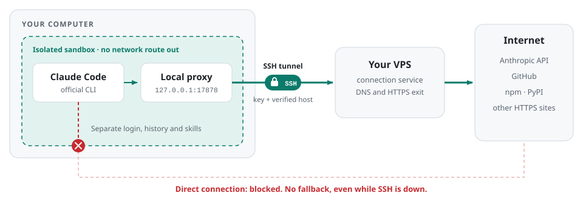
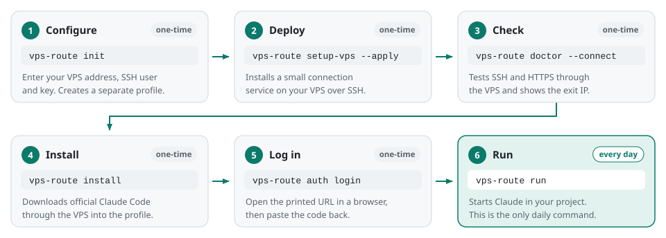
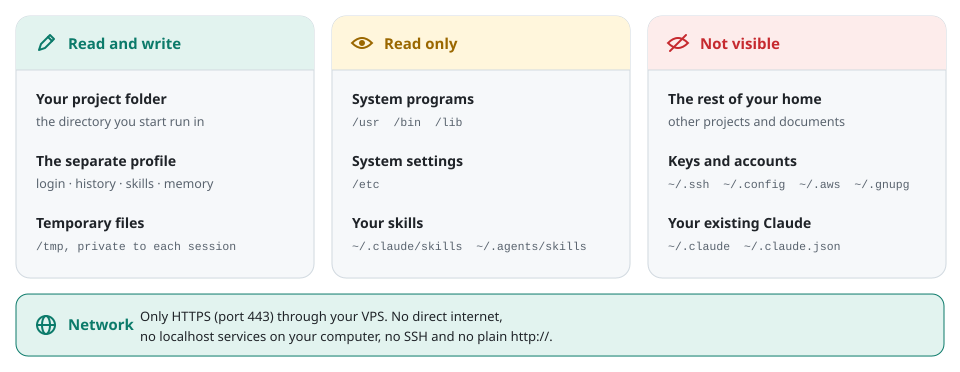

<h1 align="center">VPS Route</h1>

<p align="center">
  <b>Run Claude Code in an isolated environment that reaches the internet only through your own VPS.</b>
</p>

<p align="center">
  
  
  
  
</p>

<p align="center">
  English · <a href="README.zh-CN.md">简体中文</a>
</p>

<picture>
  <source media="(prefers-color-scheme: dark)" srcset="docs/images/network-path-en-dark.svg">
  
</picture>

## Why VPS Route

- **One way out by default.** Claude Code and its Linux commands live in a network namespace with
  no route to the internet. The only exit is a local proxy, carried over SSH to your VPS.
- **No silent fallback.** If SSH drops, your session stays open while VPS Route reconnects
  to the same VPS. Nothing is ever sent directly from your computer.
- **A separate Claude.** Installation, login, history and skills live in their own profile.
  Your existing `~/.claude` folder and `claude` command stay exactly as they are.
- **Official Claude Code.** Setup runs Anthropic's official installer through your VPS.
  VPS Route bundles and patches nothing.
- **Small and readable.** Python standard library only, on your computer and on the VPS.
  The VPS side is a single systemd service.

## Platforms

| Platform | Status |
| --- | --- |
| Linux | Supported. Verified on Ubuntu 22.04; other distributions are untested. |
| macOS | Supported on the separately maintained [`macos-support`](https://github.com/sidiangongyuan/vps-route/tree/macos-support) branch. See [macOS](#macos). |
| Windows (WSL2) | Supported on this branch; verified with Ubuntu 22.04. See [Windows](#windows-wsl2). |

## Windows (WSL2)

Install and run this branch inside WSL2 Ubuntu; see the [Chinese Windows guide](docs/WINDOWS.zh-CN.md).
Default mode isolates Windows execution, runtimes and drive files outside the selected project.
Explicit `vps-route run --windows` enables Windows programs and WSLg. Those host programs
use Windows networking and user permissions; the Linux Claude process keeps its VPS route.

## Requirements

- **Your computer:** Linux with Python 3.10+ (including `/usr/bin/python3`), bubblewrap,
  OpenSSH, curl, Bash and git. Unprivileged user namespaces must be allowed.
- **Your VPS:** Linux with systemd, `/usr/bin/python3` 3.10+, SSH key login, and outbound
  HTTPS and DNS. A non-root user needs a working systemd user service.
- **You:** an SSH key for the VPS, its host fingerprint checked through your provider, and
  a Claude account that can use Claude Code.

## Install

On Ubuntu or Debian:

```bash
sudo apt-get install python3 python3-venv pipx git bubblewrap openssh-client \
  netcat-openbsd curl ca-certificates
pipx install "git+https://github.com/sidiangongyuan/vps-route.git@v0.4.0"
pipx ensurepath
```

Open a new terminal and check `vps-route --version`. The package is not published on PyPI.

## First-time setup

<picture>
  <source media="(prefers-color-scheme: dark)" srcset="docs/images/first-run-en-dark.svg">
  
</picture>

```bash
vps-route init
vps-route setup-vps --apply
vps-route doctor --connect
vps-route install
vps-route auth login
vps-route auth status --text
```

- **`init`** asks for the VPS IP address, SSH user, port, key, `known_hosts` file and the
  service socket path on the VPS. The defaults fit most setups. The
  [complete walkthrough](docs/FIRST_RUN.zh-CN.md) (Chinese) explains every field.
- **`setup-vps --apply`** installs the connection service on the VPS. It changes no SSH,
  VPN or firewall settings. Skip it if the VPS already runs a compatible service.
- **`doctor --connect`** must report `"connectivity_ok": true` before you log in.
  `observed_exit_ip` shows the current exit for information.
- **`auth login`** prints an official login URL. VPS Route does not route your browser, so
  open the URL in a browser on the network you intend to use with this account, then paste
  the one-time code back into the same terminal.

Running `init` or `install` again is safe: existing config, login and history are kept.

## Daily use

```bash
cd ~/projects/my-app
vps-route run
```

This also works in a VS Code Remote SSH terminal.

| Task | Command |
| --- | --- |
| Check the route and the exit IP | `vps-route doctor --connect` |
| Check login | `vps-route auth status --text` |
| Update Claude Code | `vps-route update` |
| Update VPS Route | `vps-route self-update --apply` |
| Show the Claude Code version | `vps-route native-version` |
| Resume a conversation | `vps-route run -- --resume SESSION_ID` |
| Start without customizations | `vps-route run --safe-mode` |
| Show the recent connection log | `vps-route logs --tail 20` |

## What Claude can access

<picture>
  <source media="(prefers-color-scheme: dark)" srcset="docs/images/isolation-en-dark.svg">
  
</picture>

Project `CLAUDE.md` files, rules, automatic memory and skills work as usual. Skills in
`~/.claude/skills` and `~/.agents/skills` are loaded read-only; a skill with the same name
in the profile takes precedence. Hooks, MCP servers, account connectors, remote control and
cloud skill sync are turned off.

Inside a session, anything other than HTTPS through the VPS fails: SSH and `git push` over
SSH, `http://` URLs, ports other than 443, LAN addresses and services on your computer's
`localhost`. Run those in a normal terminal.

For work that needs more of your files, the optional `research_filesystem` setting mounts
your home folder plus `/mnt`, `/media`, `/opt` and `/srv`, while still hiding common
credential locations. Add your own entries to hide with `private_home_entries`:

```bash
vps-route config set research_filesystem true --apply
vps-route config set private_home_entries '[".my-vpn", ".tool-*"]' --apply
```

Turn it on only for trusted work. [Security](docs/SECURITY.md) lists what stays visible.

## How the connection behaves

- Before launch, VPS Route checks HTTPS through your VPS against two independent sites.
  One success is enough.
- During a session there are no periodic probes. Claude shows request errors and retries
  on its own, and VPS Route never closes Claude because of a network outage.
- When SSH drops, VPS Route reconnects to the same VPS after 5, 10, 20 and 30 seconds,
  then every 30 seconds. It never switches VPS and never connects directly.
- A host-key or authentication failure stops reconnecting and shows a notice. Fix the
  cause, then restart the session.
- `install`, `update` and `auth login` stop when SSH drops or two route checks in a row fail.
- A changed exit IP never stops Claude. `doctor --connect` reports the observed exit IP and a
  `diagnosis` that names the failing layer: local setup, SSH, the VPS service, or the
  VPS's own upstream.

## Optional features

### Long-lived token

Instead of browser login, you can import a token created by the official
`claude setup-token` command, for example with `vps-route run -- setup-token`:

```bash
vps-route auth import-token
vps-route auth status --text
```

Paste the token at the hidden prompt. It is stored with mode `0600` in the profile and
takes priority over browser login for new sessions. Use `auth import-token --replace` to
swap it and `auth remove-token --apply` to delete the local copy. Treat it like a password;
see [Security](docs/SECURITY.md#setup-token-credentials).

### Tab completion

```bash
source <(vps-route completion zsh)    # Bash: source <(vps-route completion bash)
```

Add the same line to `~/.zshrc` or `~/.bashrc` to load it in every new terminal.

### Orca multi-agent control

From an Orca-managed Linux terminal, `vps-route run --orca` lets Claude control the local
Orca runtime. `vps-route config set orca_control true --apply` turns this on for Orca
terminals automatically. Orca can start terminals and agents on the host, outside the
sandbox, so enable it only when you want to grant that.
See [Security](docs/SECURITY.md#optional-orca-control).

## Update and uninstall

Close all VPS Route sessions, then:

```bash
vps-route self-update                       # show the current and latest release
vps-route self-update --apply               # install the latest release
vps-route self-update --rollback --apply    # go back to the previous version
```

Updates come only from published GitHub releases. If `self-update` fails, reinstall a
release directly, for example
`pipx install --force "git+https://github.com/sidiangongyuan/vps-route.git@v0.4.0"`.
If `vps-route server-version` then reports `"compatible": false`, run
`vps-route setup-vps --apply` again.

To uninstall, review the list first:

```bash
vps-route uninstall --dry-run
vps-route uninstall
```

This permanently deletes local profiles, login, history, backups, logs, config and the
package. Keep your Claude data with `--keep-profiles --keep-backups`. The VPS is left
untouched; to remove its service, run
`systemctl --user disable --now vps-route-connect.service` there (omit `--user` for root).

## macOS

macOS support lives on the [`macos-support`](https://github.com/sidiangongyuan/vps-route/tree/macos-support)
branch, maintained by a collaborator and tested on a real Mac. It isolates Claude with the
built-in Seatbelt sandbox and needs Homebrew `pipx`.

```bash
pipx install "git+https://github.com/sidiangongyuan/vps-route.git@macos-support"
vps-route macos-check
```

Follow the [macOS guide](https://github.com/sidiangongyuan/vps-route/blob/macos-support/docs/MACOS.zh-CN.md)
(Chinese) for the rest of the setup. To update, run the same `pipx install --force` command.
Do not use `self-update` on a Mac: it installs releases from `main`, which do not include
macOS support yet.

## Troubleshooting

| Symptom | What to do |
| --- | --- |
| `vps-route: command not found` | Run `pipx ensurepath` and open a new terminal. |
| `network_isolation_unavailable` | Install bubblewrap. Ubuntu 23.10 and later restrict unprivileged user namespaces through AppArmor; an administrator can add an AppArmor profile that allows `userns` for `/usr/bin/bwrap`, which relaxes system policy. Do not try to skip the isolation check. |
| SSH host key verification failed | Confirm the fingerprint through your VPS provider. Keep verification on. |
| SSH login fails or times out | Check the user, key, port, and the local proxy if you configured one. |
| `git push`, SSH or `http://` fails inside Claude | Expected: sessions only allow HTTPS through the VPS. Use a normal terminal. |
| Claude shows connection errors and retries | Wait for Claude's retries while SSH reconnects. If they run out, check with `vps-route doctor --connect`, then retry the request. |
| Exit IP is empty but connectivity is fine | The IP lookup service is unavailable. This does not affect use. |
| Numbers like `35;142;34M` appear after exit | Run the system `reset` command, or open a new terminal tab. |
| Anything else | Run `vps-route doctor --connect --report ~/vps-route-report.json` and `vps-route logs --tail 50`, remove your exit IP if you wish, and open an issue. |

More detail: [usage guide](docs/USAGE.zh-CN.md) (Chinese) · [first-time setup](docs/FIRST_RUN.zh-CN.md) (Chinese) · [security](docs/SECURITY.md).

## Security and privacy

VPS Route controls the network path of Claude Code and the processes it starts. It does
not cover:

- your browser, links you open outside the terminal, editor extensions or other apps;
- hostile code: Claude can read everything in the project folder you start it in;
- what your VPS provider can see, which includes destinations and connection timing;
- how your traffic looks to remote services: it does not mask OS details, judge IP
  reputation or prevent account restrictions.

Logs record connection events and timings. They never contain prompts, login codes or
tokens. To report a vulnerability privately, see [SECURITY.md](docs/SECURITY.md#reporting-a-vulnerability).

## License

[MIT](LICENSE). Claude Code is installed separately under Anthropic's terms.
VPS Route is an independent project and is not affiliated with or endorsed by Anthropic.
