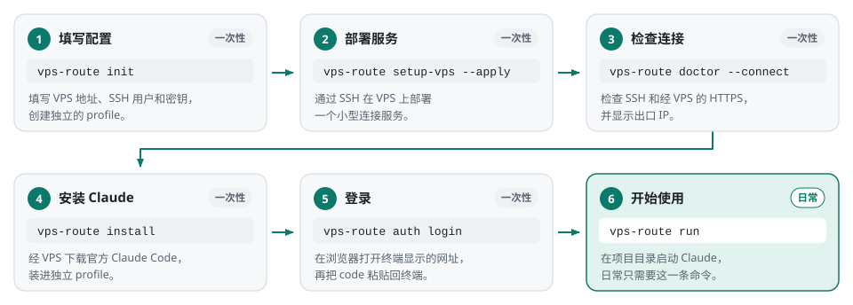

# 首次配置：完整例子

这份文档从零开始，带你在 Linux 电脑上配置好 VPS Route。文中的 `xxx` 都是占位符，
要换成你自己的信息。除了标明“在 VPS 上”的操作，其余命令都在运行 Claude 的 Linux 电脑上执行。

macOS 的安装步骤和差异见
[macOS 使用说明](https://github.com/sidiangongyuan/vps-route/blob/macos-support/docs/MACOS.zh-CN.md)，
其余步骤与本文相同。

<picture>
  <source media="(prefers-color-scheme: dark)" srcset="images/first-run-zh-dark.svg">
  
</picture>

## 1. 准备信息

| 信息 | 示例 | 从哪里获取 |
| --- | --- | --- |
| VPS 地址 | `xxx.xxx.xxx.xxx` | VPS 控制台显示的 IP。必须填数字 IP，不能填域名 |
| SSH 端口 | `22` | VPS 服务商或管理员提供，没改过通常是 22 |
| SSH 用户 | `xxx` 或 `root` | 能用密钥登录 VPS 的用户 |
| 本机私钥路径 | `~/.ssh/id_ed25519_vps_route` | 你电脑上的私钥文件 |
| 主机记录文件 | `~/.ssh/known_hosts` | 核对过 VPS 指纹后，SSH 保存记录的文件 |
| VPS 服务路径 | `/home/xxx/.local/state/claude-launcher/connect.sock` | 见下文。它是 VPS 上的文件路径 |

私钥只留在你的电脑上，VPS 上的 `~/.ssh/authorized_keys` 里放对应的公钥。
还没有配置密钥登录的话，先在本机生成一把专用密钥：

```bash
ssh-keygen -t ed25519 -f ~/.ssh/id_ed25519_vps_route
```

询问 passphrase 时直接回车留空：VPS Route 会在后台自动重连 SSH，没法替你输入密码。
提示文件已存在时输入 `n`，不要覆盖已有密钥。然后把 `~/.ssh/id_ed25519_vps_route.pub`
的内容交给 VPS 管理员装进 `authorized_keys`；自己的 VPS 就自己添加。

通过 VPS 控制台或管理员核对主机指纹，然后测试登录：

```bash
ssh -i ~/.ssh/id_ed25519_vps_route -p 22 xxx@xxx.xxx.xxx.xxx
```

第一次连接会显示指纹并询问 `yes/no`。确认和控制台上的一致后输入 `yes`，
指纹会记进 `~/.ssh/known_hosts`。能登录进去就输入 `exit` 退出。

不需要事先知道出口 IP 或国家。配置完成后，`doctor --connect` 会显示实际出口；
如果 VPS 自己还接了上游代理，出口 IP 可能和 VPS 的连接 IP 不同。

VPS 服务路径通常是：

```text
/home/xxx/.local/state/claude-launcher/connect.sock
```

`root` 用户是 `/root/.local/state/claude-launcher/connect.sock`。
如果 VPS 用户的 HOME 不在默认位置，换成它实际的 HOME。
这个文件由 `setup-vps` 自动创建，不用提前建立。

## 2. 安装工具

你的电脑和 VPS 上的 `/usr/bin/python3` 都需要 3.10 或更新。客户端目前只在 Ubuntu 22.04
上验证过。Ubuntu 或 Debian 安装依赖和工具：

```bash
sudo apt-get install python3 python3-venv pipx git bubblewrap openssh-client \
  netcat-openbsd curl ca-certificates
pipx install "git+https://github.com/sidiangongyuan/vps-route.git@v0.4.0"
pipx ensurepath
```

安装后重新打开终端。不用 pipx 的话，也可以装进虚拟环境：

```bash
python3 -m venv ~/.venvs/vps-route
~/.venvs/vps-route/bin/pip install "git+https://github.com/sidiangongyuan/vps-route.git@v0.4.0"
```

用虚拟环境时，把下文的 `vps-route` 换成 `~/.venvs/vps-route/bin/vps-route`。

## 3. 填写连接信息

执行 `vps-route init`。下面是填写示例，不能整段复制执行：

```text
VPS SSH user [vpsuser]: xxx
VPS numeric IP (not a hostname): xxx.xxx.xxx.xxx
VPS SSH port [22]: 22
Existing SSH private key path [~/.ssh/id_ed25519]: ~/.ssh/id_ed25519_vps_route
Verified known_hosts file [~/.ssh/known_hosts]:
Private socket on VPS [/home/xxx/.local/state/claude-launcher/connect.sock]:
Independent profile name [default]:
Local HTTP proxy for SSH; blank means direct SSH:
Process timezone; blank means host default:
```

方括号里是默认值，直接回车即可采用。时区留空就行，不会改动系统时区。

如果你的电脑要经本机代理才能连上 VPS，在 `Local HTTP proxy for SSH` 一项填本机代理的
HTTP 地址，例如 `http://127.0.0.1:7897`。这里只填你电脑上的代理。环境里的全局代理变量
不会自动用于 SSH；TUN 模式的 VPN 仍可能承载 SSH 连接。

也可以复制 [config.example.json](../config.example.json)，改好后导入：

```bash
cp config.example.json my-route.json
chmod 600 my-route.json
# 编辑 my-route.json，填好自己的信息后执行：
vps-route init --from-file ./my-route.json
```

配置保存在 `~/.config/vps-route/config.json`，不要把填好的配置提交到 GitHub。
重复执行 `init` 会复用已有的配置和资料，并补建缺失的目录；配置有冲突时报错，不会覆盖原文件。
`init` 不清空账号，也不会自动安装 Claude、登录或改动 VPS。

## 4. 部署服务并登录

```bash
vps-route setup-vps --apply
vps-route doctor --connect
vps-route install
vps-route auth login
```

- **`setup-vps --apply`** 只在 VPS 上增加本工具的服务，不改 SSH、VPN 和防火墙。
  VPS 上已有兼容的服务时可以跳过。非 root 用户需要可用的 systemd 用户服务；
  提示用户服务不可用时，请 VPS 管理员检查该用户的 user manager 和 linger 设置
  （例如 `sudo loginctl enable-linger xxx`）。
- **`doctor --connect`** 显示 `"connectivity_ok": true` 并正常退出后再继续。
  `observed_exit_ip` 是当前的出口，仅供查看；查询失败或出口变化都不影响使用。
- **`install`** 经 VPS 下载官方最新版 Claude Code。已经装过会提示并跳过，以后更新用
  `vps-route update`。

登录步骤：

1. 执行 `vps-route auth login` 后，让这个终端保持等待。
2. 在你打算让这个账号使用的网络环境中，用浏览器打开终端显示的完整官方网址，不要改动参数。
   VPS Route 不提供浏览器或远程桌面，也不会替浏览器选择出口。
3. 完成授权后，把页面给出的完整一次性 code 粘贴回同一个终端，回车。
4. 执行 `vps-route auth status --text` 确认已经登录。

登录失败要重来时，必须用新打印的网址和对应的新 code，不能和旧的混用。

## 5. 开始使用

```bash
cd /你的项目路径
vps-route run
```

以后不用再初始化或安装。VS Code Remote SSH 的终端里也是同一条命令。
会话里 `/status` 显示的代理是 `http://127.0.0.1:17878`，实际出口以 `doctor --connect`
为准。这个地址只在隔离环境里有效，不要填进浏览器。

| 本机路径 | 内容 |
| --- | --- |
| `~/.config/vps-route/config.json` | VPS 连接配置 |
| `~/.local/share/claude-launcher/profiles/default/.local/bin/claude` | Claude Code 安装入口 |
| `~/.local/share/claude-launcher/profiles/default/.claude/` | 登录、会话、技能和记忆，不要分享 |
| `~/.local/state/claude-launcher/logs/usage.jsonl` | 简要连接日志，不记录提示词和 token |

`~` 指运行本工具的 Linux 用户的 HOME。改过 profile 名称的话，把 `default` 换成实际名称。

## 常见问题

| 情况 | 处理 |
| --- | --- |
| 提示找不到 `vps-route` | 执行 `pipx ensurepath` 后重新打开终端，或者使用虚拟环境里的完整路径 |
| `network_isolation_unavailable` | 先确认装了 bubblewrap。Ubuntu 23.10 及以后的版本默认用 AppArmor 限制非特权用户命名空间，可能导致这个错误，本工具没在这些版本上验证过。可以请管理员为 `/usr/bin/bwrap` 添加允许 `userns` 的 AppArmor 配置后重试，这会放宽系统策略。不要尝试绕过隔离检查 |
| Claude 里 `git push`、SSH 或 `http://` 失败 | 会话里只能访问公网 HTTPS（443 端口），这类命令请在普通终端执行 |
| `self-update` 失败 | 先确认所有会话都已关闭、网络能访问 GitHub；仍然失败就执行 `pipx install --force "git+https://github.com/sidiangongyuan/vps-route.git@v0.4.0"` 重装（把版本号换成最新的） |
| SSH 主机指纹校验失败 | 通过服务商或管理员核对指纹，保持校验开启 |
| SSH 登录失败或超时 | 检查用户名、密钥、SSH 端口，以及配置的本机代理有没有运行 |
| 出口 IP 显示为空，但连通正常 | IP 查询服务暂时不可用，不影响使用，稍后再运行 doctor |
| 提示 Claude 已经安装 | 正常现象，直接登录或运行；升级用 `vps-route update` |
| 提示配置冲突 | 原配置已保留。核对导入的文件，不要用 init 强行覆盖 |
| 登录 code 无效 | 使用最新一次登录终端对应的网址和完整 code，不要重复使用旧 code |
| Claude 提示连接错误、正在重试 | 等 Claude 自己重试，SSH 会在后台重连。重试用完后用 `vps-route doctor --connect` 检查，恢复后再手动重试请求 |
| 提示 SSH 验证失败、停止重连 | 核对密钥和 VPS 指纹，保持指纹校验开启；修好后退出并重新启动 |
| 使用中 Claude 退出 | 用 `vps-route logs --tail 50` 区分是手动停止、SSH 无法重连，还是 Claude 自己退出 |
| 退出后终端出现 `35;142;34M` 一类数字 | 执行系统命令 `reset`（它和 `vps-route reset` 无关），无效就新开一个终端标签页 |
| 需要反馈问题 | 附上 `vps-route doctor --connect --report ~/vps-route-report.json` 生成的文件和 `vps-route logs --tail 50` 的输出，分享前可以删掉出口 IP |

其他操作见 [使用说明](USAGE.zh-CN.md)。
