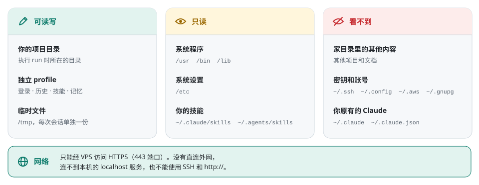
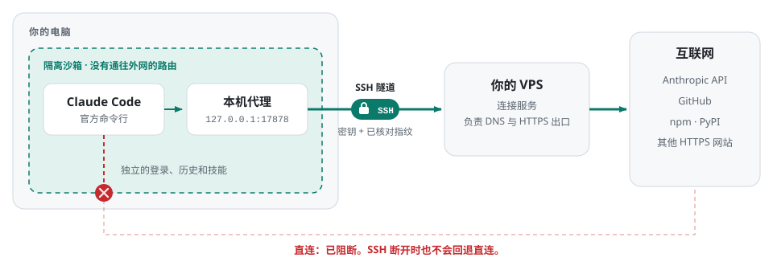

# VPS Route 使用说明

VPS Route 在独立环境中运行官方 Claude Code，所有网络流量经你自己的 VPS 出去；
连接失败时不会回退直连。这份说明覆盖 Linux 版的全部日常操作。
目前已在 Ubuntu 22.04 上验证，其他发行版未经测试。macOS 版见
[`macos-support` 分支](https://github.com/sidiangongyuan/vps-route/blob/macos-support/docs/MACOS.zh-CN.md)。

本工具不包含 Claude 账号、VPS 或浏览器，也没有发布到 PyPI。
第一次使用请先看 [完整配置例子](FIRST_RUN.zh-CN.md)。

## 1. 安装

你的电脑需要 Python 3.10+（包括 `/usr/bin/python3`）、bubblewrap、OpenSSH、curl、Bash 和 git，
并且必须允许非特权网络命名空间，否则工具会拒绝启动。VPS 需要系统 Python 3.10+、systemd、
SSH 密钥登录和外网访问。

Ubuntu 或 Debian：

```bash
sudo apt-get install python3 python3-venv pipx git bubblewrap openssh-client \
  netcat-openbsd curl ca-certificates
pipx install "git+https://github.com/sidiangongyuan/vps-route.git@v0.4.0"
pipx ensurepath
```

找不到 `vps-route` 时重新打开终端。虚拟环境的安装方法见完整配置例子。

## 2. 首次配置和登录

先准备好能登录 VPS 的 SSH 私钥，并通过服务商或管理员核对主机指纹。

```bash
vps-route init
vps-route setup-vps --apply
vps-route doctor --connect
vps-route install
vps-route auth login
vps-route auth status --text
```

- `init`：填写 VPS 信息，创建或复用独立环境。不清空账号、历史或本机原有资料。
- `setup-vps --apply`：在 VPS 上安装本工具的连接服务；已有兼容服务时可以跳过。
- `doctor --connect`：检查连通性，并显示当前的出口 IP。不要求固定 IP。
- `install`：经 VPS 下载官方最新版 Claude Code。已经安装时提示并跳过。
- `auth login`：显示官方登录网址；把授权 code 粘贴回发起登录的同一个终端。

登录网页走哪条网络由你决定，本工具不接管浏览器流量。
环境已经正常的话，不需要重新 `init` 或 `install`。
配置冲突、损坏或安装入口异常时会报错，不会自动覆盖原文件。

### 使用长期 token（可选）

完成 `init` 和 `install` 后，可以导入官方 `claude setup-token` 生成的长期 token，代替浏览器登录。
生成方法：运行 `vps-route run -- setup-token`，在官方网页确认授权，命令最后会输出 token。
请自己妥善保存，再在要使用它的电脑上导入：

```bash
vps-route auth import-token
vps-route auth status --text
vps-route run
```

按隐藏提示粘贴 token。工具把它保存在当前 profile 的 `.launcher-auth/setup-token`：
目录权限 `0700`，文件权限 `0600`。只有之后新启动的 Claude 会话会使用它；
已有会话、网页登录资料、历史和 VPS 设置都保持原样。
导入和本地状态查询只检查格式、存储和认证来源，token 在服务端是否有效，要等 Claude 实际发出请求才知道。
格式错误、权限异常或符号链接会阻止启动，工具不会自动换用其他凭据。

- 替换已有 token：`vps-route auth import-token --replace`
- 切回网页登录：先运行 `vps-route auth remove-token` 预览，再执行
  `vps-route auth remove-token --apply`，最后运行 `vps-route auth login`
- 移除只删除本机副本；要在服务端撤销 token，需要另外操作
- `reset` 会把 token 和旧 profile 一起封存；卸载时按 profile 和备份的保留选项处理
- 导入不会清空旧历史。切换账号前，先想清楚要用哪个独立 profile

请像保管长期密码一样保管 token。它只注入选定的 Claude 及其子进程；同一系统用户和管理员仍然能读取。
外部终端里的其他认证变量照常被过滤，VPS 线路和断线保护不受影响。
长期 token 的权限和功能范围见[官方说明](https://code.claude.com/docs/en/authentication#generate-a-long-lived-token)。

### Tab 命令补全

在当前终端启用：

```bash
# Zsh：
source <(vps-route completion zsh)

# Bash：
source <(vps-route completion bash)
```

把对应的 `source` 一行加进 `~/.zshrc` 或 Bash 实际读取的启动文件，之后新终端会自动加载。
例如输入 `vps-route au` 后按 Tab，或输入 `vps-route auth imp` 后按 Tab。
补全覆盖命令、子命令、选项和路径，过程中不读取账号和连接配置，也不连接 VPS。

## 3. 日常使用

```bash
cd /你的项目路径
vps-route run
```

VS Code Remote SSH 的终端里也是同样的操作。
安装本工具不会接管已有的 `claude` 命令，也不会配置 Claude 的 VS Code 扩展。

| 操作 | 命令 |
| --- | --- |
| 检查连接与出口 | `vps-route doctor --connect` |
| 查看登录状态 | `vps-route auth status --text` |
| 更新 Claude Code | `vps-route update` |
| 更新 VPS Route 本身 | `vps-route self-update --apply` |
| 查看 Claude Code 版本 | `vps-route native-version` |
| 恢复会话 | `vps-route run -- --resume 会话ID` |
| 排查技能或项目配置问题 | `vps-route run --safe-mode` |
| 查看最近的连接日志 | `vps-route logs --tail 20` |
| 列出正在运行的 VPS Route 进程 | `vps-route status` |

独立资料位于 `~/.local/share/claude-launcher/profiles/default/`，其中 `.claude/` 保存登录、
历史、技能和记忆。改过 profile 名称的话，把 `default` 换成实际名称。不要分享这个目录。

本机原有的 `~/.claude`、`~/.claude.json` 和已有的 `claude` 命令不会被移动或删除，
`reset` 和 `uninstall` 也不会碰它们。

### Claude 能访问什么

<picture>
  <source media="(prefers-color-scheme: dark)" srcset="images/isolation-zh-dark.svg">
  
</picture>

支持项目里的 `CLAUDE.md`、规则、自动记忆和技能。独立 profile 的 `.claude/skills/` 优先加载，
本机 `~/.agents/skills/` 和 `~/.claude/skills/` 中符合要求的技能也会以只读方式加载。
Hooks、MCP、账号 connectors、remote control 和云端技能同步都已关闭。

在 `vps-route run` 会话里，只有经 VPS 访问公网 HTTPS（443 端口）能连通，
包括 Claude API、`pip` 和 `npm` 下载，以及 HTTPS 网页。以下操作在会话里**不可用**：

- 经 SSH 的 `git push`、`git clone`（`git@github.com:...`），以及任何 SSH 连接
- `http://` 网址和 443 以外的端口
- 内网地址，以及你电脑上运行的服务（宿主机的 `localhost`）

这类命令请在普通终端里执行。

需要访问更多文件时，可以打开 `research_filesystem`。它会挂载家目录以及 `/mnt`、`/media`、
`/opt`、`/srv`，并继续隐藏常见的凭据位置；用 `private_home_entries` 追加你自己的条目：

```bash
vps-route config set research_filesystem true --apply
vps-route config set private_home_entries '[".my-vpn", ".tool-*"]' --apply
```

只在可信的工作中打开它，具体范围见 [安全说明](SECURITY.md#optional-research-mode)。

### 在 Orca 里使用（可选）

需要在 Orca 中做多智能体编排时，从 Orca 管理的 Linux 终端启动：

```bash
vps-route run --orca
```

`--orca` 明确授权当前 Claude 调用本机的 Orca 运行时。目前适配 Orca 的 Linux 远程 Node CLI
包装器；工具读取 `ORCA_CLI_COMMAND` 来选择同一个版本，不会自动换到其他 Orca。
沙箱里可以使用 `orca-ide` 或 `orca`，它们只连接指定的本地 Unix socket。
工具只挂载所需的 CLI、临时连接信息和 socket，`.orca` 里的账号和历史数据库保持隐藏，
宿主网络也不会打开。普通的 `vps-route run` 默认不开放这个接口。

要让同一个 profile 下 Orca 启动的主、子 Claude 都自动启用，执行一次：

```bash
vps-route config set orca_control true --apply
```

只有启动终端提供了 `ORCA_CLI_COMMAND` 时才会自动启用，普通 SSH 终端不受影响。
关闭自动启用：`vps-route config set orca_control false --apply`，新会话生效。

Orca 能替你在宿主机上启动终端和 agent，这些操作不在 Claude 的网络隔离范围内。
新建的 Claude 必须仍然通过 VPS Route 启动；不要使用会绕开这个入口的独立程序或 Chat 界面。
本功能不会自动更改 Orca 的 agent 配置、账号、hooks 或模型设置。
Orca 重启或升级后，需要重新启动这个 Claude 会话，以获取新的连接信息。

## 4. 连接保护

Claude 在你的电脑上运行，只有网络流量经过 VPS。网络路径是：

<picture>
  <source media="(prefers-color-scheme: dark)" srcset="images/network-path-zh-dark.svg">
  
</picture>

会话里 `/status` 显示的代理应为 `http://127.0.0.1:17878`。它只存在于隔离环境里，
整个系统并不使用它。最终出口请用 `doctor --connect` 核对，只看代理端口不够。

**启动前：** 经 VPS 并行访问两个独立的检测网站，任一连通即可启动。

**会话中：**

- 不再定期访问检测网站，也不插入额外的断开或恢复提示。请求错误和重试由 Claude 自己显示和处理，
  工具不会因为断网关闭 Claude。
- SSH 断开时会话保持打开，工具自动重连原来配置的 VPS：失败后依次等待 5、10、20、30 秒，
  之后每 30 秒重试一次。不会换用其他 VPS、绕过配置的本机代理或回退直连。
- SSH 主机指纹或身份验证失败时停止自动重连，提示你检查配置后手动重启；不会自动信任新指纹。
- 上游代理断开但 SSH 仍然正常时，工具不会反复重建 SSH，由 Claude 的请求重试等待恢复。
- 工具不会自动补发提示词。Claude 自带的重试用完后，需要在线路恢复后手动重试请求。
- 出口 IP 或国家变化不会导致退出。
- 等待期间网络隔离保持不变，没有直连的备用线路。Claude 自己崩溃或主动退出不属于线路问题。

**一次性命令：** 登录、安装、更新等命令在 SSH 断开或连续两轮检查失败时结束并返回错误。
`runtime_probe_interval_seconds` 和 `runtime_probe_failures` 只控制这类命令的周期检测。

**日志：** 记录启动前检测的目标编号、耗时、失败类别，以及 SSH 断开和重连事件，不记录对话内容。
SSH 重连成功只说明 SSH 恢复了，上游和 API 是否恢复，以 Claude 实际请求的结果为准。

### 用 `doctor --connect` 排查

- `connectivity_ok: true` 表示连通；`observed_exit_ip` 显示当前出口，IP 查询失败只给出提示，
  不影响连通结果。
- `diagnosis` 给出故障范围、中文说明 `summary_zh`、下一步建议，以及 `not_checked`
  （还没检查到的环节）。它能区分本机依赖或本机代理、SSH 授权或指纹、VPS 连接、
  VPS 上的代理服务，以及转发 HTTPS 的故障。
- SSH 超时只能说明 VPS 或中间路径需要排查，单凭超时无法确定是哪一方的问题；
  还没到达的上游也无法据此判断。
- `doctor --connect` 还会在本机直接测试 `connectivity_urls` 里的检测网站：配置了
  `ssh_http_proxy` 就只通过那个代理测试，否则使用系统网络。这些请求不带 Claude 凭据，
  也不跟随重定向。`stages` 里的 `local_network` 显示本机测试结果和所用路径，任一网站成功即可。
- 本机测试失败时仍会继续检查 VPS，避免检测网站本身的故障挡住诊断。本机测试成功而 SSH 失败，
  说明要排查 VPS、SSH 或通往 VPS 的路径；两者都失败，优先检查本机网络或 VPN。
- 这些额外测试只在手动诊断时运行，日常启动和会话重试的行为不变。

诊断适用于任何上游服务商和 VPS 自己的出口，不要求固定出口 IP。
旧配置里的 `expected_ip`、`expected_country` 会被自动忽略，不需要重新初始化。
`connectivity_urls` 设置 HTTPS 检测目标；`probe_url` 只用于 doctor 查询出口信息。

### 终端显示

手动终止工具等异常退出时，会自动重置终端，正常运行时的鼠标功能不受影响。
重置可能清空当前屏幕显示，但不会删除 Claude 的会话记录。
如果终端仍在不停输出坐标数字，先执行系统命令 `reset`；无效就新开一个终端标签页。

浏览器、点击后在本机打开的链接、VS Code 扩展和其他应用都不受这层网络保护。
更多边界见 [安全说明](SECURITY.md)。

## 5. 更新

`vps-route update` 更新的是 Claude Code。更新 VPS Route 本身用 `self-update`，
需要先关闭它启动的所有会话。默认只预览，加上 `--apply` 才会安装，而且只安装 GitHub 上正式发布的版本：

```bash
vps-route self-update                      # 查看当前版本和最新版本
vps-route self-update --apply              # 升级到最新版本
vps-route self-update --rollback --apply   # 回到升级前的版本
```

`self-update` 直接读取 GitHub 公开的发布信息，不需要登录 GitHub。
如果失败，可以直接重装某个版本（把版本号换成最新的）：

```bash
pipx install --force "git+https://github.com/sidiangongyuan/vps-route.git@v0.4.0"
```

虚拟环境安装的话，执行
`~/.venvs/vps-route/bin/pip install --force-reinstall "git+https://github.com/sidiangongyuan/vps-route.git@v0.4.0"`。

更新本机工具不会自动更新 VPS 上的服务。如果 `vps-route server-version` 显示
`"compatible": false`，再执行一次 `vps-route setup-vps --apply`。

## 6. 卸载

```bash
vps-route uninstall --dry-run
vps-route uninstall
```

先预览再确认。默认永久删除本机的工具资料、登录、历史、历史备份、日志和配置，
并移除支持自动卸载的安装包。VPS 上的服务、SSH 密钥和你的项目都不会被删除。
想保留 Claude 资料，加上 `--keep-profiles --keep-backups`；`-y` 只跳过确认提示。

要移除 VPS 上的服务，在 VPS 上执行
`systemctl --user disable --now vps-route-connect.service`（root 用户去掉 `--user`），
再删除 `~/.local/share/claude-launcher/server` 和对应的 unit 文件。
